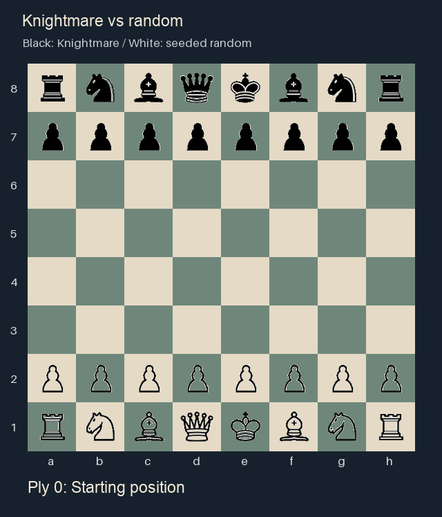
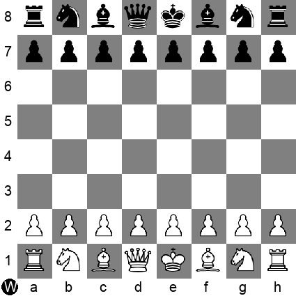

# Knightmare

Knightmare is a chess engine built to explore minimax, alpha-beta pruning, and the heuristics that help a computer choose a move. It includes a console interface and a Pygame board where you can play against the AI or watch two AIs play.



*An animation rendered from the actual recorded moves, rather than a capture of the Pygame interface. It shows the full game, from the starting position to checkmate. Knightmare plays Black at a search depth of two plies. White chooses uniformly from its legal moves using seed 7. Black wins with **24...Nd4#**. This is a demonstration against a deliberately weak baseline, not a rating test.*

[Download the game as PGN](docs/winning-game.pgn) · [Move-by-move record](docs/winning-game.json)

## Our motive

Chess gives us a familiar setting for studying adversarial search. The rules define which moves are possible, but deciding which move is useful requires looking ahead and comparing positions.

Our goal was to build a small engine where those choices could be examined directly. We explored how board representation, search depth, and different evaluation functions affect the moves it makes.

## Playing the AI

Use Python 3.10 or newer. Run these commands from a terminal:

```sh
git clone https://github.com/TheDeafOne/Knightmare.git
cd Knightmare
python -m venv .venv
```

Activate the environment with `source .venv/bin/activate` on macOS/Linux, or `.venv\Scripts\activate` on Windows. Then run:

```sh
python -m pip install -r requirements.txt
python main.py
```

Choose `c` for the console or `g` for the graphical interface. In the GUI, open **Options** to choose human vs. human, human vs. AI, or AI vs. AI, and set the search depth. Select a piece, then a highlighted destination. Press **Escape** to return to the menu.

A ply is one move by one player. Start at depth two: deeper searches take longer, and the GUI waits while the engine thinks. Interactive pawn promotions become queens; the board API also accepts rook, bishop, and knight promotions.



## How it works

### Board representation

The board uses twelve 64-bit integers, one for each piece type and color. A set bit marks a square occupied by that type of piece. These are **bitboards**; Zobrist hashing is a separate technique and is not used here.

[board.py](game_logic/board.py) manages piece placement and reversible moves. Each search move saves the complete state, including captured pieces, castling rights, en passant, and move history, so exploring one branch does not change another.

[rules.py](game_logic/rules.py) separates geometric attacks from legal moves. Candidate moves are filtered for king safety. It handles castling, en passant, promotion, checkmate, and stalemate. Threefold repetition and the fifty-move rule are claimed automatically; basic insufficient-material draws are recognized. It does not try to recognize every possible dead position.

### Search and evaluation

[minimax.py](algorithms/minimax.py) searches legal moves to the selected depth. Alpha-beta pruning skips branches that cannot improve the current choice. Positions are evaluated from the starting player's perspective, and checkmate takes priority over heuristic scores.

[evaluations.py](algorithms/evaluations.py) contains the project's hand-written heuristics, including material, central control, development, mobility, attacks, defended pieces, and king safety. These are simple rules rather than a learned model.

The original README estimated the engine at **roughly 600 Elo**. That was an informal estimate. The corrected version has not been rated in a controlled match series, and the recorded win above does not establish an Elo rating.

## Paper

Our [research paper](using_minimax_in_chess.pdf) discusses the original engine and the effect of different evaluation functions. The current implementation includes later correctness repairs, so the paper's experiments describe the earlier version.

## Reproducing the recording

The game recorder plays the engine against a seeded random opponent, checks every move and board position against the independent `chess` library, and writes the complete GIF, PGN, and JSON record. It reuses the project's existing piece images.

```sh
python -m pip install -r requirements-demo.txt
python tools/record_game.py --seed 7 --depth 2
```

This writes to `docs/`. It only writes a winning recording when the game actually ends with Black delivering checkmate; another seed can draw or lose.

## Checking the engine

With the demonstration dependencies installed:

```sh
python -m unittest discover -s tests -v
```

The regression checks cover opening move counts through three plies (20, 400, and 8,902), independent legal-move comparisons over seeded games, special moves, pins, double check, captures and undo, tactical choices, mate, stalemate, and repetition. These establish specific behavior; they are not a playing-strength benchmark.
